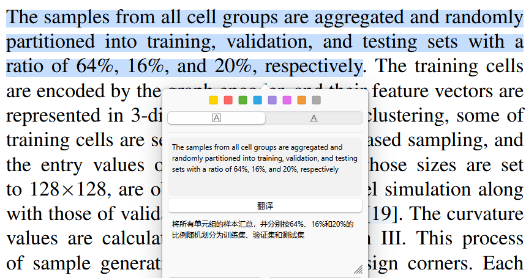
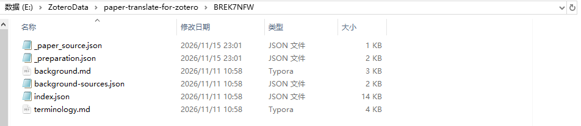

# Paper Translate for Zotero

[](https://github.com/Woif-sha/paper-translate-for-zotero/actions/workflows/ci.yml)
[](LICENSE)

在 Zotero Reader 中划词，直接查看中文译文。论文经 `llm-for-zotero` 解析后，插件会结合相关段落、论文背景和术语表辅助翻译；尚未解析时，也能翻译选中或手动输入的文本。

[下载插件](https://github.com/Woif-sha/paper-translate-for-zotero/releases) · [更新记录](CHANGELOG.md) · [反馈问题](https://github.com/Woif-sha/paper-translate-for-zotero/issues)



_划词后在浮层中查看译文，也可以修改原文后重新翻译。_

## 主要功能

- **划词与手动翻译**：在 Reader 中选中文本，或在侧栏粘贴、编辑原文，流式查看译文。
- **论文上下文**：从当前论文中查找相关章节和相邻段落，结合论文背景与双语术语表，帮助理解缩写和专业词义。
- **图片取词**：框选论文图片中的文字，用当前模型识别后翻译，识别结果可编辑。需要完整的 MinerU 解析结果和支持图片输入的模型。
- **段落与公式排版**：保留段落、列表顺序，支持 Markdown 与 LaTeX 数学公式；清理已识别的跨页版权、授权和下载提示。
- **多服务商与模型**：支持 Codex 登录和 API Key，可保存多个服务商与模型，在侧栏切换当前模型。

当前目标语言固定为中文（`zh-CN`）。译文默认只包含翻译结果，不附加背景分析，也不会写入 Zotero 批注或笔记。

## 安装与首次配置

### 1. 安装插件

需要 Zotero **7.9.9–10.9.9**，以及至少一个可用的模型。

1. 从 [GitHub Releases](https://github.com/Woif-sha/paper-translate-for-zotero/releases) 下载 `.xpi` 文件。
2. 打开 Zotero 的“工具 → 插件”，点击右上角齿轮，选择“从文件安装插件”。
3. 选中下载的 XPI，完成安装后重启 Zotero。

普通文本翻译可以直接使用。若要启用论文上下文、知识准备和图片取词，再完成下方的[论文解析准备](#启用论文上下文)。

### 2. 配置服务商与模型

打开 Zotero 设置中的 **Paper Translate for Zotero → AI 服务商**，点击已有卡片展开配置，或点击“添加服务商”。


_可以保存多个服务商；图中的名称和型号仅为配置示例，请选择自己账户可用的模型。_

| 认证方式                     | 配置方法                                                                                                                                                 |
| ---------------------------- | -------------------------------------------------------------------------------------------------------------------------------------------------------- |
| **Codex Auth（Codex 登录）** | 先安装 Codex CLI，并在终端运行 `codex login`。插件读取本机 Codex 登录状态，再从模型目录中选择可用型号。                                                  |
| **API Key（API 密钥）**      | 填写服务商名称，选择接口预设，填写 HTTPS API 地址与 API Key，再选择模型。自定义接口需要明确选择 Chat Completions、Responses 或 Anthropic Messages 协议。 |


_以 Codex 登录为例：连接参数、模型选择、推理强度和“保存”按钮都在展开的服务商卡片中。_

连接信息完整后会自动加载模型目录；可用“刷新模型”重新获取，或选择“自定义型号…”手动填写。“显示全部”可查看默认筛选之外的型号，“批量选择模型”可一次添加多个型号。

配置完成后点击**“保存”**，再到 Reader 侧栏的**“当前模型”**中选择要使用的型号。表单会记住未保存的输入，但保存后才生效；保存本身不会自动切换当前模型。也可通过设置页模型行的“⋯”菜单使用该模型。

模型行的“测试”可分别检查文本与图片能力，测试不是保存或选择模型的前置条件。翻译、知识准备和图片取词共用当前模型；切换模型会取消原来仍在运行的模型任务。

### 3. 开始翻译

打开一篇论文，在 Reader 中选中文本，浮层会自动显示译文。你也可以在“论文上下文翻译”侧栏输入或粘贴文本，再点击“翻译”。原文框可以编辑，修改后可重新提交。

在设置的“翻译”页签中，可以关闭“自动翻译 Reader 选区”，改为手动点击“翻译”。源语言可设置，也会进行自动检测；目标语言固定为中文。

## 启用论文上下文

如果希望翻译时参考整篇论文的相关内容，请先安装并配置 [llm-for-zotero](https://github.com/yilewang/llm-for-zotero)，用它的 MinerU 功能解析**当前附件**，然后回到 Reader。

本插件会读取并校验解析结果，建立章节索引，在后台整理论文背景、双语术语和可选的外部资料。背景与术语不必全部准备完成，已有的选区或输入文本即可翻译，后续翻译会使用已经准备好的内容。


_侧栏集中显示当前论文、模型和知识文件进度；下方可以输入原文并查看译文。_

- **知识文件**：查看正文身份、章节索引、论文背景、双语术语和外部补充的准备状态。
- **打开目录**：查看当前论文的本地背景与术语文件。`terminology.md` 中的中文译法可以人工调整。
- **停止与重试**：运行时可点击“停止准备”；失败或停止后，按提示使用“重新准备”或“重试外部补充”。这些操作只处理当前论文的知识任务，翻译可以继续。

知识准备是有限的后台任务，不会持续搜集资料；停止或失败后不会自动重跑。**API Key 模式目前尚未适配外部联网补充**，该阶段会显示提示；论文内背景、术语和普通翻译仍可使用，图片取词取决于当前模型是否支持图片输入。

`llm-for-zotero` 负责解析，本插件负责翻译，两者的模型设置、提示词和历史相互独立。本插件不会自行读取或解析 PDF；论文正文上下文只来自校验通过的 MinerU Markdown。

## 翻译图片中的文字

适用于图表标注等无法直接划词的文字，需要先完成上述论文解析，并选择支持图片输入的模型。

1. 在 Reader 侧栏点击**“图片取词”**。
2. 在论文图片上拖出矩形，框住需要识别的文字；按 `Esc` 可取消。
3. 等待识别结果进入可编辑的原文框。开启自动翻译时会随即翻译；关闭时，点击“翻译”提交。
4. 如识别有误，修改原文后重新翻译。

图片取词使用当前附件对应的本地 MinerU 图片。解析缓存还需要包含 `content_list.json` 及其引用的图片文件；缺文件、无法唯一对应选区或模型不支持图片时会提示失败。识别文字只用于本次翻译，不会写入论文背景或术语表。

## 本地文件与数据使用

每篇论文的背景、术语和进度保存在：

```text
<Zotero 数据目录>/paper-translate-for-zotero/<父条目 key>/
```

通过侧栏“打开目录”即可访问。下面是一篇论文完成知识准备后的目录示例：



| 文件                      | 保存什么                                                                                             | 有什么用                                               |
| ------------------------- | ---------------------------------------------------------------------------------------------------- | ------------------------------------------------------ |
| `background.md`           | 论文所属领域、研究问题、工作流、方法组件、实验与评价语境，以及翻译风险；外部补充与论文依据分开保存。 | 帮助理解论文和消除词义歧义，背景分析不会附加到译文中。 |
| `terminology.md`          | 论文中的原词、规范英文、统一中文译法、含义说明与正文证据。                                           | 翻译时优先参考，帮助统一专业词汇；可人工调整中文译法。 |
| `background-sources.json` | 外部检索问题、采纳的来源网址及其用途。                                                               | 核查外部背景的依据；没有采纳来源也可以正常完成。       |
| `index.json`              | 章节及正文分块的位置索引。                                                                           | 帮助按选区查找相关段落，不另存一份论文正文。           |
| `_paper_source.json`      | Zotero 条目、附件与 MinerU 正文的对应关系和校验信息。                                                | 确认当前上下文属于这篇论文。                           |
| `_preparation.json`       | 各项知识文件的准备进度、失败原因与重试记录。                                                         | 让侧栏在重新打开论文后仍能显示已保存的进度。           |

成功图片取词后还会生成 `ocr-cache.json`，缓存识别结果，避免对相同区域重复请求；这些文字不参与论文背景或术语准备。

条目移入 Zotero 回收站时这些文件仍保留，父条目永久删除后才会清理。

翻译会把原文及所需的论文上下文发送给当前模型服务；图片取词会发送对应的局部图片。API Key 保存在 Zotero 插件偏好中，Codex Auth 使用本机 Codex 登录凭据；凭据不会写入论文上下文文件、日志或导出文件。

## 常见问题

### 没有 MinerU Markdown，还能翻译吗？

可以。尚未解析或缓存文件不完整时，划词和手动输入仍可直接翻译，论文上下文、知识准备和图片取词暂不可用。先在 `llm-for-zotero` 中解析当前附件，再点击侧栏的“重新检查”，不必重启 Zotero。

如果提示来源或附件映射校验失败，请重新解析当前附件；不要复制其他附件的 `full.md`，插件会检查来源身份和内容是否匹配。

### 模型连接失败怎么办？

Codex Auth 提示登录失效时，在终端重新运行 `codex login`。API Key 模式请检查接口预设或协议、HTTPS 地址、密钥和模型 ID，再用模型行的“测试”查看结果。插件不会在失败后自动切换到其他服务商、接口或模型。

### 知识文件没有全部完成，需要等待吗？

不需要等论文背景、双语术语和外部补充全部完成。它们在后台准备；侧栏若显示失败或警告，可查看原因后手动重试。外部补充没有找到可采纳来源也可能正常完成，不要求凑够固定数量。

### 图片取词失败怎么办？

确认当前附件已完整解析，并用“图片测试”检查模型是否支持图片输入。尽量框选单张图片内部的文字区域；插件需要将选区唯一对应到 MinerU 图片，不能对任意 PDF 区域进行截图识别。认证、额度或接口报错则按实际提示处理。

### 跨页划词仍混入页眉、页脚怎么办？

当前已处理部分 IEEE 版权、授权、下载提示和独立页码，其他出版商的格式仍可能需要补充。可在 [Issues](https://github.com/Woif-sha/paper-translate-for-zotero/issues) 提供混入的原始选区文本和复现步骤，请勿附上密钥、登录凭据或未公开论文全文。

## 致谢与许可

Reader 交互和部分 Zotero 插件结构来自 [Translate for Zotero](https://github.com/windingwind/zotero-pdf-translate)。MinerU 缓存约定、Codex 认证、模型服务商注册和 OpenAI-compatible 传输设计参考了 [llm-for-zotero](https://github.com/yilewang/llm-for-zotero)。复用范围和提交哈希见 [NOTICE](NOTICE)。

本项目使用 [AGPL-3.0-or-later](LICENSE) 许可。
