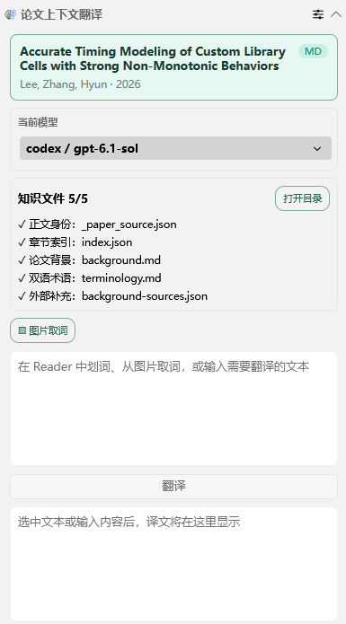
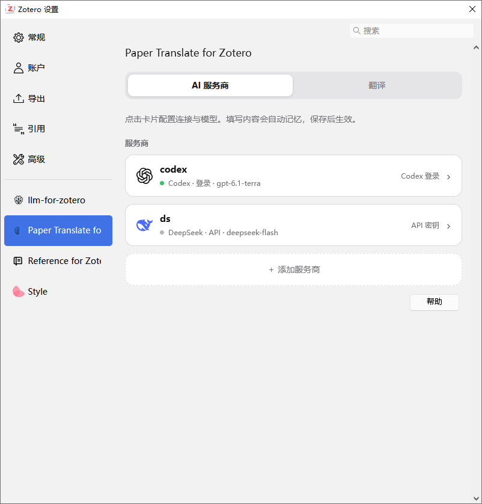
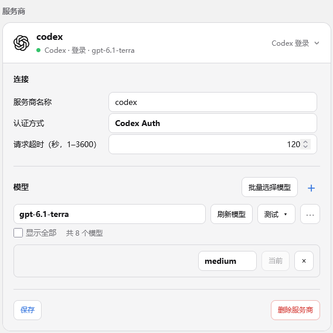

# Paper Translate for Zotero

论文里的专业词和缩写，常常要联系前文定义、研究对象和方法才能理解。**Paper Translate for Zotero** 在 Zotero 阅读器中提供结合论文上下文的中文翻译：从已解析的论文中查找相关段落，参考研究背景和双语术语表，帮助理解当前选中的内容。

你可以在原文旁直接查看译文，也可以翻译图表中的文字。每篇论文整理出的背景和术语会保留在本地，供后续阅读使用。

[下载插件](https://github.com/Woif-sha/paper-translate-for-zotero/releases) · [开始使用](#开始使用) · [更新记录](CHANGELOG.md) · [反馈问题](https://github.com/Woif-sha/paper-translate-for-zotero/issues)

## 功能介绍

### 在原文旁查看译文

读到不熟悉的句子或段落时，选中文字即可在浮层中查看中文译文，继续对照原文阅读。你也可以在侧栏粘贴文本，或修改原文后重新翻译。

译文会保留段落和列表结构，支持 Markdown 与 LaTeX 公式显示。跨页划词时，插件会清理已识别的版权、授权和下载提示，减少混入译文的页脚文字。

### 结合论文理解专业词义

一段选区未必包含缩写的定义，也未必能说明某个词在当前研究中的含义。翻译时，插件会查找同一篇论文的相关章节和相邻段落，再结合研究背景与术语表辅助判断词义。

论文背景帮助模型理解作者在研究什么、采用了什么方法；双语术语表则为专业名词提供统一的中文译法。背景只用于理解原文，默认显示的内容仍然是选区的译文。

论文上下文需要先由 [llm-for-zotero](https://github.com/yilewang/llm-for-zotero) 的 MinerU 功能解析当前附件。背景和术语随后在后台整理，不必等所有知识文件准备完成再翻译；尚未解析论文时，划词和手动输入仍可直接翻译。

### 背景和术语随论文保留

同一篇论文里的方法名、缩写和专业概念会反复出现。插件会按论文保存背景与双语术语，再次打开时可以继续使用。对于希望固定译法的词，你可以直接修改术语表中的中文翻译，让后续翻译优先参考自己的用词。

这些内容保存在可查看的本地文件中。通过侧栏的“打开目录”，可以阅读论文背景、调整术语，也可以核查外部补充采用了哪些来源。

查看各文件保存的内容

文件保存在 `<Zotero 数据目录>/paper-translate-for-zotero/<父条目 key>/`，每篇论文各有一个目录。

| 文件                      | 内容                                                                                                             |
| ------------------------- | ---------------------------------------------------------------------------------------------------------------- |
| `background.md`           | 论文所属领域、研究问题、工作流、方法组件、实验与评价语境，以及翻译时需要留意的歧义。外部补充与论文依据分开保存。 |
| `terminology.md`          | 论文中的原词、规范英文、中文译法、含义说明与正文证据。可以人工调整中文译法。                                     |
| `background-sources.json` | 外部检索问题、采纳的来源网址及其用途，便于核查背景依据。没有采纳来源也可以正常完成。                             |
| `index.json`              | 章节及正文分块的位置索引，用于查找相关段落，不另存一份论文正文。                                                 |
| `_paper_source.json`      | Zotero 条目、附件与 MinerU 正文的对应关系及校验信息，确保上下文属于当前论文。                                    |
| `_preparation.json`       | 知识准备的进度、失败原因和重试记录，用于恢复侧栏中的进度显示。                                                   |

成功图片取词后还会生成 `ocr-cache.json`，缓存识别结果，避免重复请求；识别文字不参与论文背景或术语准备。条目移入 Zotero 回收站时，上述文件仍保留，父条目永久删除后才会清理。

### 翻译图里的文字

图表标注、流程图和示意图中的文字，有时无法直接划词。通过侧栏的“图片取词”框选目标文字，插件会用当前模型识别，再沿用同一套论文上下文翻译。

识别结果会进入可编辑的原文框，方便修正公式、缩写或数值。开启自动翻译时会随即翻译；关闭时，检查原文后点击“翻译”即可。

图片取词需要完整的 MinerU 解析结果和支持图片输入的模型，使用的是当前附件对应的本地 MinerU 图片。

### 使用自己常用的模型

插件支持 Codex 登录和 API Key，可以保存多个服务商与模型，在 Reader 侧栏选择当前使用的型号。你可以沿用已有的模型服务，翻译、背景整理、术语提取和图片取词都会使用当前模型。

模型与服务商由你选择，请求失败会显示原因。图片取词需要模型支持图片输入；API Key 模式目前尚未适配外部联网补充，但可以使用论文内背景、术语和普通翻译。

_在服务商卡片中配置 Codex 模型与推理强度，已保存的模型可在 Reader 侧栏中切换使用。_

## 开始使用

最低要求为 Zotero **7.9.9**，还需准备一个可用的模型服务。当前翻译目标语言为中文。

1. 从 [GitHub Releases](https://github.com/Woif-sha/paper-translate-for-zotero/releases) 下载 `.xpi`，在 Zotero“工具 → 插件 → 齿轮 → 从文件安装插件”中安装，然后重启 Zotero。
2. 打开“设置 → Paper Translate for Zotero → AI 服务商”，配置并保存服务商，再在 Reader 侧栏选择当前模型。
3. 打开论文，选中文字开始翻译。若要使用论文上下文和图片取词，先用 `llm-for-zotero` 的 MinerU 功能解析当前附件。

首次连接模型：Codex 登录或 API Key

**Codex 登录**：先安装 Codex CLI，并在终端执行 `codex login`，然后在服务商卡片中选择账户可用的型号。

**API Key**：填写服务商名称，选择接口预设，填写 API 地址与 API Key，再选择模型。自定义接口需要明确选择 Chat Completions、Responses 或 Anthropic Messages 协议。仅本机回环地址（如 `http://127.0.0.1:8518/v1`、`localhost` 和 `[::1]`）可使用 HTTP，其他地址须使用 HTTPS。

连接信息完整后会自动加载模型目录；找不到所需型号时，可以刷新目录、开启“显示全部”，或选择“自定义型号…”手动填写。图中的型号只是配置示例，请选择自己账户可用的模型。

点击“保存”后配置才生效，保存不会自动切换当前模型。模型行的“测试”可以分别检查文本与图片能力；测试不是保存或选择模型的前置条件。

默认划词后自动翻译。若希望先检查原文，可以在设置的“翻译”页签关闭“自动翻译 Reader 选区”，再手动提交。

## 常见问题

没有解析论文，能直接翻译吗？

可以。没有 MinerU Markdown 或缓存文件不完整时，划词和手动输入仍可直接翻译；论文上下文、知识准备和图片取词需要先完成解析。解析后点击侧栏“重新检查”，不必重启 Zotero。

如果提示来源或附件映射校验失败，请重新解析当前附件，不要复制其他附件的 `full.md`。

背景或外部补充没有完成，会影响翻译吗？

不需要等论文背景、术语和外部补充全部完成。它们在后台准备，后续翻译会使用已经准备好的内容。

你可以停止当前论文的知识准备，也可以在失败后查看原因并手动重试；这些操作不影响当前翻译。停止或失败的知识任务不会自动重跑。API Key 模式暂不支持外部联网补充，该阶段会显示提示。

连接模型或图片取词失败怎么办？

Codex Auth 提示登录失效时，在终端重新执行 `codex login`。API Key 模式请检查协议、地址、密钥与模型 ID，并用模型行的“测试”查看结果。

图片取词还需要当前附件的完整 MinerU 图片与 `content_list.json`。可以先用“图片测试”检查模型支持情况，再框选单张图片内部的文字。选区无法唯一对应图片时会提示失败，插件不会改用 PDF 截图识别。

## 数据使用

翻译会将原文及所需的论文上下文发送给当前模型服务，图片取词会发送对应的局部图片。API Key 保存在 Zotero 插件偏好中；Codex Auth 使用本机 Codex 登录凭据。凭据不会写入论文上下文文件、日志或导出文件。

论文解析由 `llm-for-zotero` 完成，本插件读取校验通过的 MinerU Markdown，两者的模型设置、提示词和历史相互独立。译文不会写入 Zotero 批注或笔记。

## 致谢与许可

Reader 交互和部分 Zotero 插件结构来自 [Translate for Zotero](https://github.com/windingwind/zotero-pdf-translate)。MinerU 缓存约定、Codex 认证、模型服务商注册和 OpenAI-compatible 传输设计参考了 [llm-for-zotero](https://github.com/yilewang/llm-for-zotero)。复用范围和提交哈希见 [NOTICE](NOTICE)。

本项目使用 [AGPL-3.0-or-later](LICENSE) 许可。
